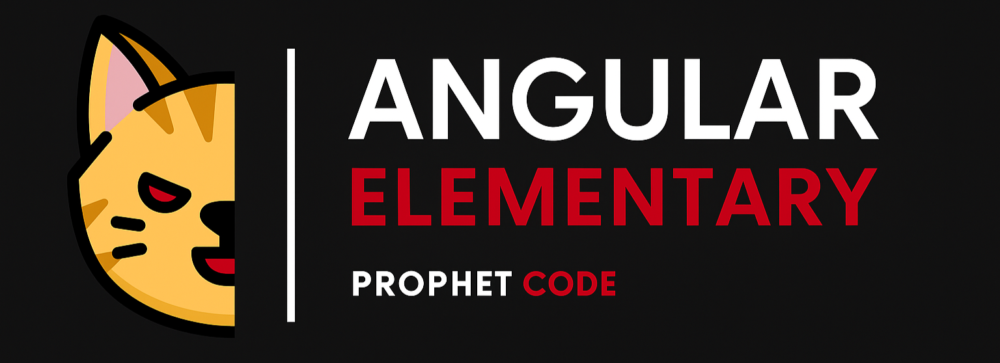

# CinemA

Aplicación de cartelera y reservaciones de cine construida con **Angular 20** (standalone, sin `NgModules`), **TypeScript 5.8** y **Tailwind CSS 4**.

> Este proyecto parte de [prophet-99/angular-elementary](https://github.com/prophet-99/angular-elementary), el proyecto del curso gratuito de Angular de su autor ([playlist en YouTube](https://youtube.com/playlist?list=PLD4CDC34D7sMfVxx037MsX3_IbZ_0mFwA)). Todo el crédito del código base es suyo; este repositorio es mi copia personal para evolucionarlo con mis propias mejoras y estilo.

## 🧱 Stack

| Herramienta  | Versión   |
| ------------ | --------- |
| Angular      | `^20.0.0` |
| TypeScript   | `~5.8.3`  |
| RxJS         | `~7.8.0`  |
| Tailwind CSS | `^4.1.7`  |
| Zone.js      | `~0.15.1` |
| Tests        | Karma + Jasmine |

## 🗂️ Arquitectura

```
src/app
├── core/        # Singleton: navbar, interceptors, services, models (+ mappers)
├── pages/       # Features enrutadas (lazy loading con loadComponent)
└── shared/      # UI reutilizable: button, modal (+ event bus), pipes
```

Alias de rutas (`tsconfig.json`): `@core/*`, `@pages/*`, `@shared/*`, `@environments/*`.

## 📦 Requisitos

- Node.js 22 o superior
- Un token de lectura (API Read Access Token) de [The Movie Database](https://www.themoviedb.org/settings/api)
- La API de reservaciones corriendo en `http://localhost:4000/api`

## ▶️ Cómo iniciar

```bash
npm ci        # instala las versiones exactas del package-lock.json
npm start     # http://localhost:4200
```

Coloca tu token de TMDB en `src/environments/environment.development.ts` (y `environment.ts` para producción):

```ts
apiKeyTheMovieDB: 'YOUR_TMDB_API_KEY', // reemplaza con tu token
```

Para que git no registre tu token por accidente:

```bash
git update-index --skip-worktree src/environments/environment.ts src/environments/environment.development.ts
```

## 🛠️ Scripts

| Script          | Descripción                          |
| --------------- | ------------------------------------ |
| `npm start`     | Servidor de desarrollo               |
| `npm run build` | Build de producción en `dist/cinema` |
| `npm run watch` | Build en modo watch (development)    |
| `npm test`      | Pruebas unitarias con Karma          |
